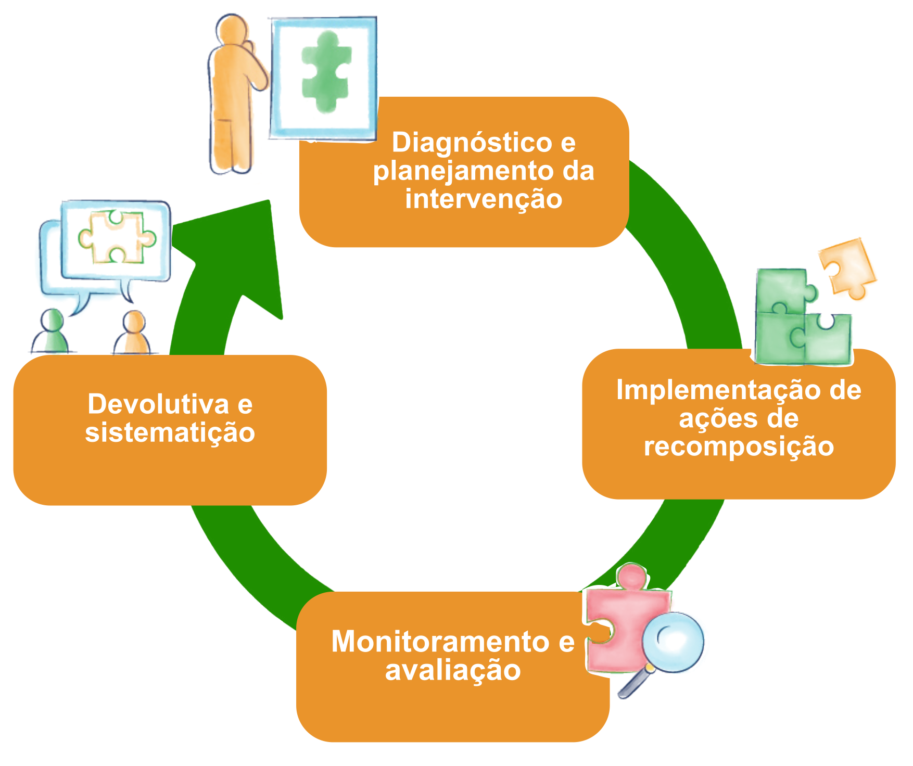

## JORNADA DE IMPLEMENTAÇÃO DA RECOMPOSIÇÃO DAS APRENDIZAGENS

Toda a estratégia da recomposição foi elaborada para ampliar a aprendizagem
dos/as estudantes cearenses de forma mais equitativa e equânime, garantindo a
justiça curricular. Agora que você já conhece os pilares do programa FOCO na
Aprendizagem, vamos detalhar como essas ações devem ser incorporadas pelas
escolas de forma que cheguem às salas de aula da nossa rede estadual.

O gráfico a seguir mostra como colocar a recomposição em prática.

{ .img-fluid style="display: block; margin-left: auto; margin-right: auto; width: 80%;" }

**Fonte:** Elaboração própria.