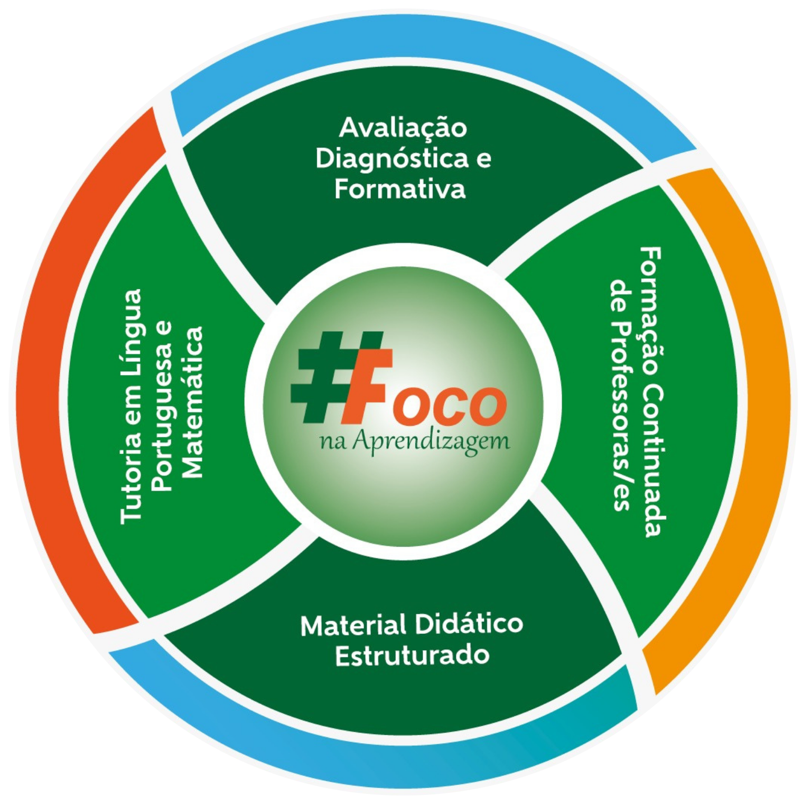

### PILARES OPERACIONAIS DO FOCO NA APRENDIZAGEM

A implementação da recomposição das aprendizagens requer recursos pedagógicos, tecnológicos e formativos acessíveis e articulados às rotinas escolares. O FOCO na Aprendizagem articula as ações didático-pedagógicas em torno da garantia do direito à aprendizagem dos/as estudantes por meio de avaliação diagnóstica e formativa, formação continuada de professores/ as, tutoria de Língua Portuguesa e Matemática e uso de MDE, com vistas à garantia da equidade nos processos educativos. 

{: class="img-fluid" style="display: block; margin-left: auto; margin-right: auto; width: 60%;" } 

>Fonte: CEARÁ. Secretaria da Educação do Estado do Ceará. Diagrama – FOCO na
Aprendizagem. Fortaleza: SEDUC-CE, 2025. Disponível em: https://www.ced.seduc.ce.gov.br/foco-2025-por-area/. Acesso em: 30 setembro 2025.